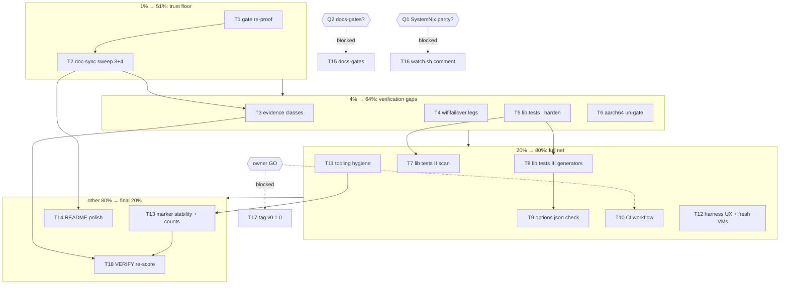

# SUPERB Pareto plan — trust-first execution (2026-11-12 22:04)

First plan in `docs/planning/` (no prior plans, no baseline). Input backlog:
`TODO_LIST.md` (12 rows at plan time) + ROADMAP parked items + owner-gated
decisions from `docs/status/2026-11-12_21-40_session-docs-overhaul-self-review.md`.

**Scope line.** VERIFIED fresh while planning: `git diff 1ed6f09..HEAD`
(mapped the parallel session's landing: modules 3+4, `lib/filesystems.nix`

- `mkFilesystem` export, 3 new VM tests, 2 new eval-contracts, harness
  groups `bootmirror`/`hottier`/`hotdirmigrate` via grep), `grep` of
  `flake.nix` checks wiring, `ls modules/ lib/`, lib/default.nix diff. NOT
  verified here: a green `nix flake check` AFTER the parallel landing (last
  full green 21:1x predates it — that is task T1), the 3 new VM tests'
  runtime behavior, the SystemNix side of every fork.

## Errata (stale backlog found and corrected during Step 0)

5. **The harness leg count "15 legs" (µ1.6, and T1's row) was a miscount** —
   execution recount: 16 legs at plan time (bootmirror 5, hottier 5,
   hotdirmigrate 6). After execution the harness carries 22 cases (17 mutation
   legs + 5 green controls) across 5 groups including the new `wififailover`
   and `lib` groups.

6. **TODO_LIST row "wifi-failover negative legs" had stale evidence** — said
   the harness "carries only the bootmirror group"; modules 3+4 added
   `hottier` + `hotdirmigrate` groups at 21:47-22:00. Corrected in place
   (the `wififailover` gap itself still stands).
7. **TODO_LIST row "aarch64" undercounted the surface** — said 2 gated
   checks; there are now 4 (3 eval-contracts + module-list). Corrected.
8. **CHANGELOG + 21:40 status report said "7 verified open items"** — the
   TODO_LIST built at 18:41 had 6 (row grep recount). Corrected in both
   (report corrected inline with strikethrough, CHANGELOG factually).
9. **No doc-sync task existed for modules 3+4** — the parallel landing
   updated FEATURES/README/CHANGELOG but left `lib/README.md` (split
   contract omits `mkFilesystem`), `AGENTS.md:141` (test-signature line:
   2 of 6 files), FEATURES lib-section wording ("both modules" with four
   shipped), and `docs/DOMAIN_LANGUAGE.md` (no hot-tier vocabulary) stale.
   Surfaced as new TODO rows + task T2 below.

## Pareto breakdown

- **1% → 51%:** T1 (gate re-proof) + T2 (doc-sync sweep). ~2.5 h. Prove the
  tree is green after the parallel landing, then make every living doc tell
  the truth about all 4 modules. Everything downstream consumes these two
  truths; without them, all other work builds on unverified ground and
  every future session reads lying docs.
- **4% → 64%:** + T3, T4, T5, T6. ~3.8 h more. Close the two standing
  verification gaps: module assertions that bite (wifi-failover legs) and
  the harden spine pinned by eval tests; plus portability (aarch64).
- **20% → 80%:** + T7-T12. ~8 h more. The full test net (lib tests II+III,
  options.json provenance proof), CI, tooling hygiene, harness UX.
- **The other 80% of work → final 20% of result:** T13-T18 + the parked
  ROADMAP tier (kill path incl. the new filesystems fork, dual-wan, audit
  gates, contract single-sourcing, options-table drift guard, boot-mirror
  VM leg, renovate). Necessary for maturity, not for the next step change
  in trust.

## Comprehensive plan — medium granularity (30-100 min, sorted)

Sorted by importance → impact → effort → customer-value (customer = the
SystemNix consumer + every future agent session).

| #   | Task                                                                                                                                                                                  | Tier | Impact   | Effort | Category      | Depends on | Blocked by                             |
| --- | ------------------------------------------------------------------------------------------------------------------------------------------------------------------------------------- | ---- | -------- | ------ | ------------- | ---------- | -------------------------------------- |
| T1  | Gate re-proof: full `nix flake check` (4 VMs, 3 contracts, formatting, module-list); fix anything red                                                                                 | 1%   | High     | 60m    | Quality       | —          | —                                      |
| T2  | Doc-sync sweep modules 3+4: lib/README split list, FEATURES wording + mkFilesystem row, AGENTS test-signature line, DOMAIN_LANGUAGE hot-tier vocabulary, TODO evidence                | 1%   | High     | 90m    | Documentation | T1         | —                                      |
| T3  | FEATURES evidence-class alignment: define 3 classes (in-repo test / extraction-parity+production / none), re-status rows mechanically                                                 | 4%   | High     | 30m    | Quality       | T2         | —                                      |
| T4  | wifi-failover negative legs: `wififailover` group (gateway assert, dual-wan conflict, green control)                                                                                  | 4%   | High     | 90m    | Quality       | T1         | —                                      |
| T5  | Lib eval tests I: harden family (lifecycle throw, MemoryHigh derivation, parseMemoryBytes, passthrough case-sensitivity)                                                              | 4%   | High     | 80m    | Quality       | T1         | —                                      |
| T6  | aarch64: un-gate the 3 eval-contracts + module-list                                                                                                                                   | 4%   | Med      | 30m    | Quality       | T1         | —                                      |
| T7  | Lib eval tests II: extractPortLiterals (3 forms, zero-padding drop, word:NNN limitation pin) + unitExecText scan keys                                                                 | 20%  | Med      | 80m    | Quality       | T5         | —                                      |
| T8  | Lib eval tests III: generator shape smoke-evals (mkPoolDirUnit, mkSqliteBackupUnit, mkMetricTextfileCollector) + mkPortGuard assert + serviceTypes + mkFilesystem contamination guard | 20%  | Med      | 80m    | Quality       | T5         | —                                      |
| T9  | options.json render check per module (mechanically proves the path-provenance claim; module-list records paths only)                                                                  | 20%  | Med      | 90m    | Quality       | T1         | —                                      |
| T10 | CI: GitHub Actions running `nix flake check`; flip SECURITY.md line back                                                                                                              | 20%  | Med-High | 90m    | Infra         | T1         | owner GO (implied by request history)  |
| T11 | Tooling hygiene: dprint wire-or-delete, deadnix+statix in treefmt, .gitignore buildflow block, flake description charter wording                                                      | 20%  | Low-Med  | 90m    | Cleanup       | T1         | —                                      |
| T12 | Harness UX: flake app or devShell for `tests/negative/run.sh` + cache-busted fresh runs of all 4 VM checks                                                                            | 20%  | Low-Med  | 60m    | Quality       | T1         | —                                      |
| T13 | Marker-stability + count-audit sweep: dprint fmt on archived strikethrough file → check-rows re-gate; grep-audit every count in living docs                                           | rest | Med      | 30m    | Quality       | T11        | —                                      |
| T14 | README polish: license mention, design-rules/CONTRIBUTING pointer                                                                                                                     | rest | Low      | 30m    | Docs          | T2         | —                                      |
| T15 | docs-gates adoption + `.docs-gates.json`                                                                                                                                              | rest | Med      | 30m    | Process       | —          | **Q2**                                 |
| T16 | watch.sh stale GW comment fix                                                                                                                                                         | rest | Med      | 15m    | Cleanup       | —          | **Q1** (SystemNix parity coordination) |
| T17 | First release: tag v0.1.0 + CHANGELOG `[0.1.0]` section                                                                                                                               | rest | Med      | 30m    | Process       | T1-T9      | owner GO                               |
| T18 | Post-execution docs-health VERIFY re-score (new baseline)                                                                                                                             | rest | Low-Med  | 90m    | Process       | T1-T14     | —                                      |

## Fine breakdown — ≤12 min per task (ALL tasks, sorted by parent priority)

**T1 — Gate re-proof (60m)**

| µ#  | Micro-task                                                                | Est    |
| --- | ------------------------------------------------------------------------- | ------ |
| 1.1 | Run `nix flake check` (background, log to file)                           | 5m     |
| 1.2 | Read the log; classify any failure: eval-contract / VM / formatting       | 10m    |
| 1.3 | Per failure: locate offending module line, minimal fix                    | 12m ×n |
| 1.4 | Re-run only the failed check via `nix build .#checks.x86_64-linux.<name>` | 8m     |
| 1.5 | Full green re-run; record result in CHANGELOG docs entry if fixes landed  | 10m    |
| 1.6 | Also run `bash tests/negative/run.sh` (15 legs now) green                 | 12m    |

**T2 — Doc-sync sweep modules 3+4 (90m)**

| µ#  | Micro-task                                                                                                                                 | Est |
| --- | ------------------------------------------------------------------------------------------------------------------------------------------ | --- |
| 2.1 | lib/README.md: add `mkFilesystem`/filesystems.nix to "Moved here" + fork note                                                              | 10m |
| 2.2 | FEATURES.md: fix "both modules" → "all four modules" (2 spots)                                                                             | 5m  |
| 2.3 | FEATURES.md: add mkFilesystem row (status per T3 classes) + hot-tier/hot-dir-migrate already present? verify                               | 10m |
| 2.4 | AGENTS.md:141: generalize test-signature gotcha to all 6 test files                                                                        | 10m |
| 2.5 | DOMAIN_LANGUAGE.md: add hot tier, live-writer guard, depth tripwire, dropLogsDirectory neutralization, ownership heal, contamination guard | 12m |
| 2.6 | Cross-check module READMEs of modules 3+4 against their options (spot-check 2 options each)                                                | 12m |
| 2.7 | Link-check all living docs again (`grep`+`test -e` loop)                                                                                   | 8m  |
| 2.8 | Commit sweep                                                                                                                               | 5m  |

**T3 — FEATURES evidence alignment (30m)**

| µ#  | Micro-task                                                                                     | Est |
| --- | ---------------------------------------------------------------------------------------------- | --- |
| 3.1 | Write the 3 evidence classes into FEATURES.md header (one paragraph)                           | 10m |
| 3.2 | Re-status every lib row mechanically against the classes; fix serviceTypes + any flipped by T2 | 10m |
| 3.3 | Verify no row's Notes contradict its new status                                                | 10m |

**T4 — wifi-failover negative legs (90m)**

| µ#  | Micro-task                                                                                                   | Est |
| --- | ------------------------------------------------------------------------------------------------------------ | --- |
| 4.1 | Design 3 cases: green control / gateway-assert drop / dual-wan enable                                        | 12m |
| 4.2 | Write sed mutations (gateway null + no networking.defaultGateway; `services.dual-wan.enable = true` overlay) | 12m |
| 4.3 | Add `wififailover` group to run.sh with marker regexes from assertion messages                               | 12m |
| 4.4 | Run `CASES=wififailover bash tests/negative/run.sh` — expect 3 PASS                                          | 12m |
| 4.5 | Prove marker specificity: run once with a wrong regex, see it FAIL (harness bites)                           | 10m |
| 4.6 | Run full harness (all groups) green                                                                          | 12m |
| 4.7 | Update AGENTS.md harness line + FEATURES notes (wififailover group exists)                                   | 10m |
| 4.8 | Commit                                                                                                       | 5m  |

**T5 — Lib eval tests I: harden family (80m)**

| µ#  | Micro-task                                                                                                                              | Est |
| --- | --------------------------------------------------------------------------------------------------------------------------------------- | --- |
| 5.1 | Create `tests/lib-eval.nix` skeleton (lib-only eval, runCommand shape) + wire into flake checks (both systems)                          | 12m |
| 5.2 | Test: lifecycle key in harden{} throws with the named key in the message                                                                | 12m |
| 5.3 | Test: MemoryHigh default = 80% of MemoryMax arg (bytes math, 4 sizes)                                                                   | 12m |
| 5.4 | Test: explicit MemoryHigh passthrough; override-shaped values untouched                                                                 | 10m |
| 5.5 | Test: parseMemoryBytes K/M/G/T + unparsable → "80%" fallback                                                                            | 12m |
| 5.6 | Test: hardenUser omits systemOnly keys; unknown keys pass through; `memoryMax` lowercase passes through verbatim (documenting the trap) | 12m |
| 5.7 | Wire + run green; commit                                                                                                                | 10m |

**T6 — aarch64 un-gating (30m)**

| µ#  | Micro-task                                                             | Est |
| --- | ---------------------------------------------------------------------- | --- |
| 6.1 | Move the 3 eval-contracts + module-list out of the x86_64-only attrset | 10m |
| 6.2 | `nix flake check --all-systems` green (VMs stay x86_64-only)           | 12m |
| 6.3 | Update AGENTS.md aarch64 note; commit                                  | 8m  |

**T7 — Lib eval tests II: scan surface (80m)**

| µ#  | Micro-task                                                                                   | Est |
| --- | -------------------------------------------------------------------------------------------- | --- |
| 7.1 | extractPortLiterals: host-form, colon-form, flag-form cases (≥2 each)                        | 12m |
| 7.2 | extractPortLiterals: zero-padded drop ("10:00" → no port), range filter (2-65535)            | 12m |
| 7.3 | extractPortLiterals: word:NNN false-positive pinned as KNOWN behavior (resend.com:587 → 587) | 10m |
| 7.4 | extractPortLiterals: model-tag lookalike exclusion ("qwen3.6-moe:35b-a3b")                   | 10m |
| 7.5 | unitExecText: all 7 Exec keys + Environment attr/list forms appear in scan text              | 12m |
| 7.6 | Run green; update FEATURES row (audit scan surface may flip 🟢 with limitation note); commit | 12m |

**T8 — Lib eval tests III: generators + guards (80m)**

| µ#  | Micro-task                                                                                     | Est |
| --- | ---------------------------------------------------------------------------------------------- | --- |
| 8.1 | mkPoolDirUnit: shape test (RequiresMountsFor=mountRoot, caps only with owner, RemainAfterExit) | 12m |
| 8.2 | mkSqliteBackupUnit: service+timer shape, Persistent=true, RequiresMountsFor=backupDir          | 12m |
| 8.3 | mkMetricTextfileCollector: mktemp/mv wrapper text present, User=root                           | 10m |
| 8.4 | mkPortGuard: empty ownerUnits throws; owner pattern in generated script                        | 12m |
| 8.5 | serviceTypes: 4 helpers produce mkOption with right types/defaults                             | 10m |
| 8.6 | mkFilesystem: wrong-fs option throws with the named pair                                       | 12m |
| 8.7 | Run green; FEATURES serviceTypes row → 🟢 (now in-repo tested); commit                         | 12m |

**T9 — options.json render check (90m)**

| µ#  | Micro-task                                                                                                     | Est |
| --- | -------------------------------------------------------------------------------------------------------------- | --- |
| 9.1 | Prototype: `nixosSystem` eval per module with `options.json` (pkgs.lib.evalModules or toplevel options)        | 12m |
| 9.2 | Assert every option's declarations point into the module path (provenance)                                     | 12m |
| 9.3 | Render per-module options.json into $out; one derivation, 4 modules                                            | 12m |
| 9.4 | Wire as `checks.x86_64-linux.options-json` (+aarch64 after T6 shape)                                           | 12m |
| 9.5 | Negative spike: import-apply a module in a copy → check fails (proves the assert differently than module-list) | 12m |
| 9.6 | Green run; AGENTS.md one-liner; commit                                                                         | 10m |

**T10 — CI workflow (90m)**

| µ#   | Micro-task                                                                             | Est |
| ---- | -------------------------------------------------------------------------------------- | --- |
| 10.1 | `.github/workflows/check.yml`: nix-installer action + `nix flake check` on x86_64      | 12m |
| 10.2 | Push-gated on master + PRs; 20-deep nix store fetch depth settings                     | 10m |
| 10.3 | Decide VM-test timeout budget in CI (4 VM tests); possibly `-L` logs                   | 12m |
| 10.4 | SECURITY.md: revert practices line to "Automated checks run in CI via nix flake check" | 5m  |
| 10.5 | Self-test the workflow by push (needs owner GO to push branch/PR)                      | 12m |
| 10.6 | AGENTS.md CI note update; commit                                                       | 8m  |

**T11 — Tooling hygiene (90m)**

| µ#   | Micro-task                                                                                                | Est |
| ---- | --------------------------------------------------------------------------------------------------------- | --- |
| 11.1 | dprint: try treefmt dprint wiring; if clean → enable for md/json/yaml; else `trash dprint.json` + doc why | 12m |
| 11.2 | deadnix + statix programs in treefmt.nix; fix findings                                                    | 12m |
| 11.3 | .gitignore buildflow block: keep (fleet template) or trim — decide + act                                  | 10m |
| 11.4 | Flake description: keep "eval-time audit gates" (ROADMAP-backed) or reword until T-audit ships            | 10m |
| 11.5 | `nix fmt` + `nix flake check` green after tooling changes                                                 | 12m |
| 11.6 | Update AGENTS.md formatting section; commit                                                               | 10m |

**T12 — Harness UX + fresh VM runs (60m)**

| µ#   | Micro-task                                                                                         | Est |
| ---- | -------------------------------------------------------------------------------------------------- | --- |
| 12.1 | Add `apps.x86_64-linux.negative-tests = writeShellScript` wrapping run.sh                          | 12m |
| 12.2 | Doc in AGENTS.md commands block (`nix run .#negative-tests`)                                       | 5m  |
| 12.3 | Cache-busted rebuild of the 4 VM checks (`nix store delete` or `--rebuild` flag / dirty the input) | 12m |
| 12.4 | All 4 VM tests green fresh; record in status/CHANGELOG if anything moved                           | 12m |
| 12.5 | Commit                                                                                             | 5m  |

**T13 — Marker stability + count audit (30m)**

| µ#   | Micro-task                                                      | Est |
| ---- | --------------------------------------------------------------- | --- |
| 13.1 | dprint fmt on archived report → `git diff` (markers intact?)    | 10m |
| 13.2 | Re-run check-rows --strict + bare-rows on archived file         | 5m  |
| 13.3 | Count audit: every number in living docs recomputed (`grep -c`) | 12m |
| 13.4 | Fix any drift; commit                                           | 5m  |

**T14 — README polish (30m)**

| µ#   | Micro-task                                                                 | Est |
| ---- | -------------------------------------------------------------------------- | --- |
| 14.1 | Read LICENSE type; add license line/section to README                      | 10m |
| 14.2 | Add "Design rules" pointer (link README section ↔ CONTRIBUTING-style note) | 10m |
| 14.3 | Render-check links; commit                                                 | 10m |

**T15 — docs-gates adoption (30m, BLOCKED Q2)**

| µ#   | Micro-task                                                                    | Est |
| ---- | ----------------------------------------------------------------------------- | --- |
| 15.1 | `nix run github:Artmann-Technologies/docs-gates -- run .` baseline            | 12m |
| 15.2 | Seed `.docs-gates.json` thresholds; wire into T10's CI or a local gate script | 12m |
| 15.3 | Document invocation in AGENTS.md; commit                                      | 6m  |

**T16 — watch.sh comment fix (15m, BLOCKED Q1)**

| µ#   | Micro-task                                                                 | Est |
| ---- | -------------------------------------------------------------------------- | --- |
| 16.1 | Fix comment (option names), or coordinate SystemNix sweep per owner answer | 12m |
| 16.2 | Note parity-diff outcome; commit                                           | 3m  |

**T17 — Release v0.1.0 (30m, BLOCKED owner GO + T1-T9)**

| µ#   | Micro-task                                                       | Est |
| ---- | ---------------------------------------------------------------- | --- |
| 17.1 | Wrap CHANGELOG entries under `## [0.1.0] - 2026-11-1x`           | 10m |
| 17.2 | `git tag -a v0.1.0` with summary message                         | 10m |
| 17.3 | Push tag; verify consumer pin message (SystemNix) needs updating | 10m |

**T18 — Post-execution VERIFY re-score (90m)**

| µ#   | Micro-task                                                     | Est    |
| ---- | -------------------------------------------------------------- | ------ |
| 18.1 | Full docs-health VERIFY over all living docs                   | 12m ×3 |
| 18.2 | Cross-file consistency matrix                                  | 12m    |
| 18.3 | Compute new Accuracy/Fitness; write into a fresh status report | 12m    |
| 18.4 | Harvest its §f; close the loop                                 | 10m    |

## Parked (ROADMAP — not actionable; graduation criteria named)

- Kill path: SystemNix consumer migration → standing parity diff (now also
  covers the filesystems fork) → re-point SystemNix lib. Graduates when
  consumer count drops near zero.
- dual-wan module migration. Graduates when its consumer story settles.
- Eval-time audit gate modules (port-registry, gatus-coverage). Graduates
  when a consumer demands them.
- boot-mirror contract single-sourcing / drift gate; module README
  options-table drift guard. Graduate as design spikes when triplication
  actually bites.
- boot-mirror runtime VM leg; renovate/Dependabot for flake inputs.

## Execution graph

## Verification protocol (every task)

1. The task's own check green (`nix build .#checks...`, `CASES=... run.sh`,
   gates) BEFORE moving on.
2. `nix fmt` + `nix flake check` still green after edits.
3. Docs touched → link check + count recompute.
4. Done item → deleted from TODO_LIST + CHANGELOG entry (lifecycle rule).

— Plan written 2026-11-12 22:04 CET. Waiting for approval or GO.
