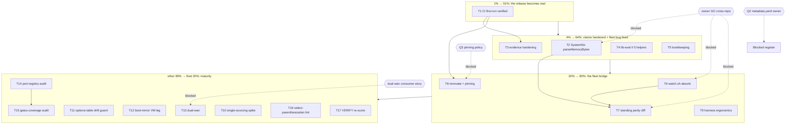

# SUPERB Pareto plan — release hardening + fleet bridge (2026-11-13 01:19)

Second plan in `docs/planning/`. Input backlog: `TODO_LIST.md` (11 task rows:
8 TODO + 3 BLOCKED, counted via grep at plan time) + `ROADMAP.md` (17
raw-idea bullets) + the living 00:58 self-review report's §f (26 routed
items). Predecessor plan (2026-11-12_22-04) executed in full — this plan
starts from tag `v0.1.0` (local) on a green tree (12 checks, 22/22 harness,
docs-gates 5/5).

**Scope line.** VERIFIED fresh while planning: TODO/ROADMAP row counts
(grep), git state (clean, HEAD 1084f21), docs-gates PASS, flake check green
(this session, twice). NOT verified here: SystemNix's current tree beyond
the 2026-11-12 helper-consumer counts (109 harden files; changes there may
have moved numbers); CI runtime behavior (workflow has NEVER executed —
first run happens with this plan's push); Renovate compatibility with the
flake layout.

## Pareto breakdown

- **1% → 51%: T1 — make the release REAL.** The push (this turn) + verified
  CI first run + honest FEATURES flip. Until origin carries the tag and a
  green checkmark, v0.1.0 is a local claim; every consumer-facing promise
  (CI, tag, provenance) completes here. ~45 min.
- **4% → 64%: + T2-T5 — harden every claim, fix the live fleet bug.**
  SystemNix's `parseMemoryBytes` crash is a REAL bug sitting in the
  production fork (T2); options-json's bite, the mergeIt approximation
  caveat, the `--rebuild` evidence wording, 5 untested helpers, and the
  bookkeeping (EXECUTED banner, tag-ref, bump flow) make every remaining
  sentence in FEATURES/CHANGELOG either bite-proven or honestly hedged
  (T3-T5). ~3.5 h more.
- **20% → 80%: + T6-T9 — the fleet bridge.** The fork stops being guarded
  by prose: watch.sh divergence absorbed or blessed (T6), a standing
  semantic parity-diff script mechanizes the forked-during-migration
  contract (T7), Renovate + pinning policy make inputs self-maintaining
  (T8, Q3), and the harness gets ergonomic enough for contributors
  (T9). ~4.5 h more.
- **The other 80% of work → final 20% of result: T10-T17 + ROADMAP parked.**
  Single-sourcing spikes, drift guards, the boot-mirror VM leg, dual-wan,
  the two audit-gate modules, the select-parenthesization lint, and the
  closing VERIFY re-score. Maturity, not the next trust step.

## Comprehensive plan — medium granularity (30-100 min, sorted)

Sorted by importance → impact → effort → customer-value (customer = the
SystemNix fleet first, then flake consumers and future sessions).

| #  | Task                                                                       | Tier | Impact | Effort | Category      | Depends on | Blocked by |
|----|----------------------------------------------------------------------------|------|--------|--------|---------------|------------|------------|
| T1 | CI first-run verification: watch the run this push triggers, fix action refs if red, flip FEATURES 🟡→🟢 | 1% | High | 45m | Infra | push (this turn) | — |
| T2 | Apply the parseMemoryBytes bare-byte fix to the SystemNix fork + regression contract | 4% | High | 45m | Quality | — | owner GO (cross-repo) |
| T3 | Evidence hardening: options-json bite leg + mergeIt doc + `--rebuild` semantics + honest VM-evidence reword | 4% | High | 60m | Quality | T1 | — |
| T4 | lib-eval II: the 5 Class-B-only helpers (mkSecretCheck, mkDesktopNotifyService, mkStateDir, wrapWithMemoryLimit, ioTier) | 4% | Med | 80m | Quality | — | — |
| T5 | Bookkeeping: SUPERB plan EXECUTED banner + CHANGELOG [0.1.0] tag-ref + version-bump flow doc | 4% | Low-Med | 30m | Docs | — | — |
| T6 | Absorb or bless the watch.sh comment divergence SystemNix-side | 20% | Med | 30m | Quality | — | owner GO (cross-repo) |
| T7 | Standing parity-diff script: SystemNix lib copies vs this lib (semantic, allowlisted divergences) | 20% | Med-High | 90m | Quality | T2, T6 | owner GO (touches SystemNix) |
| T8 | Renovate for flake inputs + CI action refs (pinning policy per owner) | 20% | Med | 60m | Infra | T1 | **Q3** (pin policy) |
| T9 | Harness ergonomics: devShell + run.sh --help + parallel legs + auto-count wiring check | 20% | Low-Med | 90m | Quality | — | — |
| T10 | boot-mirror contract single-sourcing SPIKE (4 copies → 1 source; adopt-or-park decision) | rest | Med | 90m | Quality | — | — |
| T11 | Module README options-table drift guard (generated from options-json output) | rest | Med | 90m | Docs | T1 | — |
| T12 | boot-mirror runtime VM leg (bootctl/rsync/diff actually executed in-repo) | rest | Med | 100m | Quality | — | — |
| T13 | dual-wan module migration (fleet couplings stay consumer-side) | rest | Med-High | 100m | Feature | — | consumer story settled (owner) |
| T14 | Port-registry audit-gate module (unitExecText scan + registry + allowPorts) | rest | Med | 100m | Feature | — | — |
| T15 | Gatus-coverage audit-gate module (same scan surface, zero drift) | rest | Med | 100m | Feature | T14 | — |
| T16 | Statix custom rule: unparenthesized select over application (`f x y .attr`) | rest | Low | 100m | Quality | — | — |
| T17 | Post-execution docs-health VERIFY re-score + report + harvest | rest | Low-Med | 60m | Process | T1-T11 | — |

**Blocked register (not tasks until unblocked):** `.config/metadata.yaml`
ownership (Q2, owner); SystemNix consumer-migration batches + the kill
(ROADMAP theme 1 — graduates when T7's parity diff runs standing);
dual-wan consumer story (feeds T13).

## Fine breakdown — ≤12 min per task (ALL tasks, sorted by parent priority)

**T1 — CI first-run verification (45m)**

| µ#  | Micro-task | Est |
|-----|------------|-----|
| 1.1 | Confirm push landed: `git status -sb`, `gh run list` shows the workflow queued | 5m |
| 1.2 | `gh run watch` the first run (budget 30m wall; VM tests on 2-core runner are the risk) | 12m |
| 1.3 | If red BEFORE any VM step: action-ref problem — verify `checkout@v5` / `nix-installer-action@v17` exist; pin per Q3 interim (keep @vN) | 12m |
| 1.4 | If red IN a VM step: read `-L` logs; KVM vs TCG timeout is the likely culprit — raise budget or split jobs | 12m |
| 1.5 | Flip FEATURES CI row 🟡→🟢 with run URL evidence; AGENTS CI note updated | 8m |
| 1.6 | CHANGELOG entry + commit | 5m |

**T2 — SystemNix parseMemoryBytes fix (45m, cross-repo)**

| µ#  | Micro-task | Est |
|-----|------------|-----|
| 2.1 | Read SystemNix `lib/systemd.nix` parseMemoryBytes; confirm the same null-vs-"" crash shape | 8m |
| 2.2 | Apply the identical fix (suffix null → "" mapping, comment citing this repo's find) | 12m |
| 2.3 | Port the regression contract into SystemNix's check surface (or its test dir; match its idiom) | 12m |
| 2.4 | Evaluate/build SystemNix's touched check green | 10m |
| 2.5 | Parity note in BOTH repos (CHANGELOG here: "SystemNix side fixed at rev X") | 8m |

**T3 — Evidence hardening (60m)**

| µ#  | Micro-task | Est |
|-----|------------|-----|
| 3.1 | options-json bite leg: sed the `hasSuffix "/modules/${name}"` to a wrong suffix in a copy → check must FAIL with the provenance marker | 12m |
| 3.2 | Prove marker specificity once (wrong marker → leg fails) | 10m |
| 3.3 | mergeIt limitation note in tests/lib-eval.nix header (types.anything ≈ but ≠ the real option merge) | 8m |
| 3.4 | `--rebuild` semantics: establish what it actually does (docs/quick experiment); write the truth in AGENTS commands | 12m |
| 3.5 | Re-word the VM-evidence claims in CHANGELOG/FEATURES to match established semantics | 12m |
| 3.6 | Full gates (`flake check --no-build`, harness group, docs-gates) + commit | 6m |

**T4 — lib-eval II: 5 helpers (80m)**

| µ#  | Micro-task | Est |
|-----|------------|-----|
| 4.1 | mkStateDir: tmpfiles line shape (d/path/mode/user/group/-) | 8m |
| 4.2 | mkSecretCheck: script text (name, -s test, message, extraCheck) | 12m |
| 4.3 | mkDesktopNotifyService: timer+service pair (OnBootSec/interval, user/uid wiring) | 12m |
| 4.4 | wrapWithMemoryLimit: systemd-run wrapper text + NOT-for-build-sandbox note pinned | 12m |
| 4.5 | ioTier: fragment values (interactive/background priorities) + mkMerge shape | 12m |
| 4.6 | Wire all into the contracts list; `nix build .#checks.*.lib-eval` green | 10m |
| 4.7 | FEATURES rows flip to Class A + harness `lib` group leg if any new guard bites + commit | 12m |

**T5 — Bookkeeping (30m)**

| µ#  | Micro-task | Est |
|-----|------------|-----|
| 5.1 | EXECUTED banner atop the 22-04 plan (date, 18/18, tag) | 5m |
| 5.2 | CHANGELOG `## [0.1.0]` heading gets the tag ref (link text once pushed; plain `v0.1.0` meanwhile) | 10m |
| 5.3 | Version-bump flow: 5 lines in README Development (section wrap → tag → push → SystemNix re-pin) | 12m |
| 5.4 | Commit | 3m |

**T6 — watch.sh divergence absorb (30m, cross-repo)**

| µ#  | Micro-task | Est |
|-----|------------|-----|
| 6.1 | Read SystemNix's watch.sh copy + its module's GW injection chain | 10m |
| 6.2 | Decide: its comment is TRUE for its wiring (bless = ledger note) or stale there too (fix both) | 12m |
| 6.3 | Record the verdict in the parity ledger + commit(s) | 8m |

**T7 — Standing parity-diff script (90m, cross-repo touch)**

| µ#  | Micro-task | Est |
|-----|------------|-----|
| 7.1 | Design: semantic diff (eval both, compare rendered contracts) not byte diff — files diverge legitimately | 12m |
| 7.2 | Prototype over 3 helpers (harden, mkFilesystem, serviceDefaults) | 12m |
| 7.3 | Sweep all 18 helpers | 12m |
| 7.4 | Expected-divergence allowlist (comment wording, fixed bug) | 12m |
| 7.5 | Wire: SystemNix-side check or `nix run` script; document invocation | 12m |
| 7.6 | lib/README fork section updated (prose guard → mechanized guard) | 10m |
| 7.7 | Gates + commit both sides | 10m |
| 7.8 | Soak instruction into AGENTS (run after every collection lib change) | 10m |

**T8 — Renovate + pinning (60m, BLOCKED Q3)**

| µ#  | Micro-task | Est |
|-----|------------|-----|
| 8.1 | Owner answers Q3 (floating vs SHA) | 2m |
| 8.2 | renovate.json: flake lock + github-actions managers per policy | 12m |
| 8.3 | Validate config (renovate dry-run if available; else schema check) | 12m |
| 8.4 | Cadence decision (auto-merge lock updates? PR-only for actions) | 10m |
| 8.5 | AGENTS note + commit | 8m |

**T9 — Harness ergonomics (90m)**

| µ#  | Micro-task | Est |
|-----|------------|-----|
| 9.1 | devShell: bash/git/rsync/nix + docs-gates hint | 12m |
| 9.2 | run.sh `--help` (usage, CASES/KEEP, groups list) | 12m |
| 9.3 | Parallel legs (background per group + wait; keep per-case logs) | 12m |
| 9.4 | Auto-count check: `tests/*.nix` count vs flake wiring (kills the 7→8→10 class) | 12m |
| 9.5 | Wire as `checks.*.tests-wiring` (both systems) | 10m |
| 9.6 | Full harness green in parallel mode | 12m |
| 9.7 | AGENTS/FEATURES + commit | 12m |

**T10 — boot-mirror single-sourcing SPIKE (90m)**

| µ#  | Micro-task | Est |
|-----|------------|-----|
| 10.1 | Map the 4 contract copies (module asserts, test chain, README, markers) | 12m |
| 10.2 | Pick a single-source shape (module exports its contract list; test + markers consume it) | 12m |
| 10.3 | Prototype on ONE clause (PathChanged watcher) | 12m |
| 10.4 | bootmirror negative legs still bite | 12m |
| 10.5 | Adopt-or-park decision written down (cost vs drift pain) | 12m |
| 10.6 | Commit prototype or park note | 10m |

**T11 — Options-table drift guard (90m)**

| µ#  | Micro-task | Est |
|-----|------------|-----|
| 11.1 | Render option tables from the options-json check output | 12m |
| 11.2 | Compare against module README tables (name/default presence) | 12m |
| 11.3 | Drift report shape (file, option, expectation) | 12m |
| 11.4 | Wire as a check | 12m |
| 11.5 | Fix any current drift found | 12m |
| 11.6 | Gates + commit | 10m |

**T12 — boot-mirror runtime VM leg (100m)**

| µ#  | Micro-task | Est |
|-----|------------|-----|
| 12.1 | Test design: 2 disks, mirror ESP, loader entries, boot counting | 12m |
| 12.2 | Fixture host (boot.loader + module enabled) | 12m |
| 12.3 | Scenario 1: sync runs, `diff -r` verification passes | 12m |
| 12.4 | Scenario 2: mirror detached → condition-skip, no boot stall | 12m |
| 12.5 | Scenario 3: boot-count rename reverse-propagation | 12m |
| 12.6 | Wire + green | 12m |
| 12.7 | Negative leg (verification gate dropped → bites) | 12m |
| 12.8 | Docs + commit | 10m |

**T13 — dual-wan migration (100m, consumer story gated)**

| µ#  | Micro-task | Est |
|-----|------------|-----|
| 13.1 | Read the SystemNix dual-wan module | 12m |
| 13.2 | Fleet-coupling inventory (ports registry, gatus, OIDC) | 12m |
| 13.3 | Extract the fleet-agnostic core | 12m |
| 13.4 | Eval-contract | 12m |
| 13.5 | VM leg if runtime-visible behavior exists | 12m |
| 13.6 | Negative group (2 legs) | 12m |
| 13.7 | wifi-failover conflict-assertion leg updates (both directions) | 10m |
| 13.8 | Docs + commit | 12m |

**T14 — Port-registry audit module (100m)**

| µ#  | Micro-task | Est |
|-----|------------|-----|
| 14.1 | Registry option shape (consumer-side attrset) | 12m |
| 14.2 | Audit eval over unitExecText/extractPortLiterals | 12m |
| 14.3 | Violations throw, naming unit + port | 12m |
| 14.4 | allowPorts escape honored | 12m |
| 14.5 | Eval-contract check | 12m |
| 14.6 | Negative legs (registry violation; word:NNN limitation escape) | 12m |
| 14.7 | Docs + commit | 12m |

**T15 — Gatus-coverage audit module (100m)**

| µ#  | Micro-task | Est |
|-----|------------|-----|
| 15.1 | Consumer gatus config as input (path/attrset) | 12m |
| 15.2 | Coverage eval vs listening ports (shared scan surface) | 12m |
| 15.3 | Report shape (uncovered listeners, stale checks) | 12m |
| 15.4 | Contract check | 12m |
| 15.5 | Negative legs (2) | 12m |
| 15.6 | Docs + commit | 12m |

**T16 — Select-parenthesization lint (100m)**

| µ#  | Micro-task | Est |
|-----|------------|-----|
| 16.1 | statix custom-rule API research | 12m |
| 16.2 | Pattern: application whose last arg is a select, or select after app | 12m |
| 16.3 | Prototype rule | 12m |
| 16.4 | Fixture tests (the d.4 phantom-falsehood case) | 12m |
| 16.5 | False-positive sweep over this repo + a nixpkgs sample | 12m |
| 16.6 | Wire into treefmt or park with findings | 12m |
| 16.7 | Commit | 8m |

**T17 — Post-execution VERIFY re-score (60m)**

| µ#  | Micro-task | Est |
|-----|------------|-----|
| 17.1 | Full docs-health VERIFY sweep over living docs | 12m |
| 17.2 | Cross-file consistency matrix (counts, claims, links) | 12m |
| 17.3 | Fresh status report with scores + a-g | 12m |
| 17.4 | Harvest §f; annotate/archive the 00:58 report; docs-gates green | 12m |
| 17.5 | Commit | 5m |

## Execution graph

## Verification protocol (every task)

1. The task's own check green (CI run, `nix build .#checks...`,
   `CASES=... run.sh`, docs-gates) BEFORE moving on.
2. `nix fmt` + `nix flake check` still green after edits.
3. Docs touched → link check + count recompute (grep, never memory).
4. Done item → deleted from TODO_LIST + CHANGELOG entry (lifecycle rule).
5. Cross-repo tasks (T2, T6, T7) commit in THEIR repo too; this repo's
   CHANGELOG records the bridge event.

— Plan written 2026-11-13 01:19 CET. Awaiting GO for execution.
